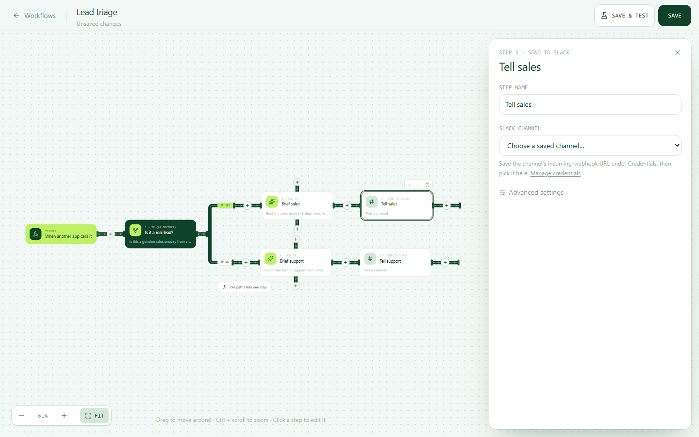
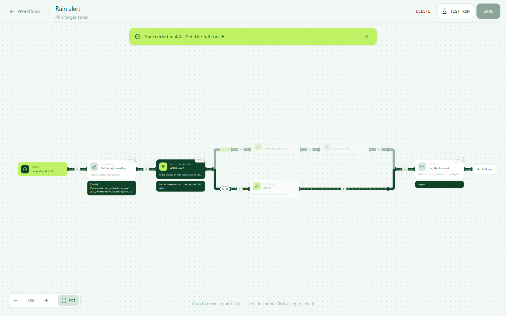
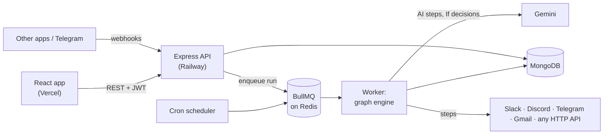

# Connuit

**AI workflow automation where the AI makes the decisions.** Chain steps on a canvas (fetch data, ask AI, post to Slack, Discord, Telegram or Gmail) and run them on a schedule, from a webhook, or when someone messages your Telegram bot. An **If** step lets the AI choose which path a workflow takes.

**Live:** [connuit.vercel.app](https://connuit.vercel.app)


## What it does

A contact form posts to your workflow's private URL → the AI decides *"is this a real sales lead?"* → **Yes:** it writes a 3-line brief for #sales. **No:** it tells #support what the person needs.



- **Visual editor.** A pan-and-zoom canvas on desktop and a vertical list on phones. Steps are friendly blocks (Hacker News, weather, any API, Ask AI, If, Slack, Discord, Telegram, Gmail) with an "Advanced" view for raw HTTP.
- **Branching.** An **If** step asks the AI a yes/no question and takes the matching path. Any step can feed up to **three** others, and paths only join again when you add a step that merges them.
- **Triggers.** By hand, on a schedule (cron, every 5 minutes at most), from another app (a private webhook URL), or from a Telegram message.
- **Placeholders.** `{{previousOutput}}`, `{{previousOutput.items[0].title}}`, `{{steps.Get news.title}}`, `{{trigger.email}}` and `{{credential}}` are filled in when the step runs, with clear errors when a field is missing.
- **Test runs you can watch.** A pulse travels along the pipes, each step shows its output, and paths the AI didn't take fade out as skipped.
- **Templates.** Lead triage, an AI assistant on Telegram, a vendor outage watch, a nudge for the pull requests waiting longest, brand mentions, and a rain alert. Each runs on free public APIs; webhook and Telegram templates include sample data so "Test run" works straight away.



## How it works



Every run, whatever started it, goes through one **BullMQ** queue on Redis. The worker loads the workflow, decrypts the credentials it needs, runs the graph, and saves every step's status and output for the dashboard's run history. A failed run is retried automatically (3 attempts, with back-off), except when retrying can't help (see the AI limits below).

## Engineering highlights

- **A graph execution engine** ([engine/graph.ts](backend/src/engine/graph.ts), [engine/runWorkflow.ts](backend/src/engine/runWorkflow.ts)). Workflows are stored as nodes and edges. Steps run in topological order (Kahn's algorithm), and loops are rejected both when saving and before running. An If step's untaken path is marked *skipped*, and that spreads down the branch. A step with several parents receives all their outputs, keyed by step name.
- **AI cost control that holds under concurrency** ([services/usageService.ts](backend/src/services/usageService.ts)). Every AI call reserves one unit against a per-user daily allowance and an app-wide cap that keeps everyone under Gemini's free tier. "Check the limit and add one" is a single MongoDB conditional upsert, backed by a unique index, so 20 runs hitting a limit of 5 at the same instant let exactly 5 through. Hitting the limit fails the run without retries.
- **Secrets stay secret.**
  - Credentials are encrypted with AES-256-GCM before they're stored, and never sent back to the browser.
  - Passwords are hashed with bcrypt, and sessions are JWTs.
  - Each Telegram-triggered workflow gets its own webhook secret, an HMAC of its token, so the server's master secret never leaves the server.
  - The Google OAuth `state` is signed with a key derived from the JWT secret, so a state seen in a URL can't be used as a login token.
- **Gmail with the least access** ([services/googleService.ts](backend/src/services/googleService.ts)). OAuth asks only for `gmail.send` (Google classes reading mail as "restricted"). Refresh tokens are stored encrypted, header values are flattened so data from a webhook can't inject `Bcc:` lines, and an expired connection produces a "reconnect Gmail" message.
- **The editor's model** ([frontend/src/dashboard/editor/model.ts](frontend/src/dashboard/editor/model.ts)). The UI edits a tree (steps, If paths, branches) and converts it to and from the API's graph. A saved graph is only accepted if converting it back gives exactly the same edges, so the editor can never quietly change a workflow.

## Tech stack

| | |
|---|---|
| **Frontend** | React 19, TypeScript, Vite, Tailwind CSS v4, React Router, GSAP |
| **Backend** | Node.js 22, Express 5, TypeScript, Zod |
| **Data** | MongoDB (Mongoose), Redis (Upstash) with BullMQ, node-cron |
| **AI & integrations** | Gemini (OpenAI-compatible API), Slack and Discord webhooks, Telegram Bot API, Gmail API (OAuth) |
| **Hosting** | Vercel (frontend), Railway (API, worker and scheduler in one process) |

## Running it locally

**You'll need:** Node.js 22+, a MongoDB database ([Atlas](https://www.mongodb.com/atlas) free tier works), a Redis URL ([Upstash](https://upstash.com) free tier works), and a [Gemini API key](https://aistudio.google.com/apikey) (free).

```bash
git clone https://github.com/deepracerchichi/connuit.git
cd connuit

# Backend: http://localhost:5000
cd backend
npm install
cp .env.example .env      # then fill in the values (see below)
npm run dev

# Frontend: http://localhost:5173 (in a second terminal)
cd frontend
npm install
cp .env.example .env
npm run dev
```

### Backend settings (`backend/.env`)

| Variable | Needed | What it is |
|---|---|---|
| `MONGODB_URI` | yes | MongoDB connection string |
| `REDIS_URL` | yes | Redis connection string, for the run queue (`rediss://…` for Upstash) |
| `JWT_SECRET` | yes | At least 32 random characters, used to sign logins |
| `ENCRYPTION_KEY` | yes | 64 hex characters (32 bytes), for encrypting credentials |
| `GEMINI_API_KEY` | yes | From Google AI Studio |
| `FRONTEND_URL` | | Where the app runs, for CORS. Default `http://localhost:5173` |
| `PORT` | | Default `5000` (don't set it on Railway) |
| `LLM_MODEL` | | Default `gemini-3.5-flash-lite` |
| `AI_CALLS_PER_USER_PER_DAY` | | Default `50` |
| `AI_CALLS_PER_DAY_TOTAL` | | Default `450`, which stays under Gemini's free daily limit |
| `TELEGRAM_WEBHOOK_SECRET` | for Telegram triggers | Any long random string (letters, digits, `_`, `-`) |
| `PUBLIC_API_URL` | for Telegram triggers | The API's public `https://` address. Worked out automatically on Railway |
| `GOOGLE_CLIENT_ID`, `GOOGLE_CLIENT_SECRET` | for Gmail | An OAuth "Web application" client from Google Cloud, with the redirect URI `<API address>/oauth/google/callback` |

To generate the two secrets:
```bash
node -e "console.log(require('crypto').randomBytes(32).toString('hex'))"   # run twice: JWT_SECRET, ENCRYPTION_KEY
```

### Frontend settings (`frontend/.env`)

| Variable | What it is |
|---|---|
| `VITE_API_URL` | The backend's address, e.g. `http://localhost:5000` |

## Deploying

- **Railway (backend).** Root directory `backend`, build `npm run build`, start `npm start`, and the variables above. Run **one instance**: the cron scheduler and the queue worker live in the API process.
- **Vercel (frontend).** Root directory `frontend`, with `VITE_API_URL` set to the Railway address. `frontend/vercel.json` sends every route to `index.html`, so refreshing on `/login` works.

## Project structure

```
backend/src
  engine/       graph order, the run loop, step execution, placeholders, AI calls
  queue/        BullMQ queue and worker (retries)
  scheduler/    cron triggers
  routes/       auth, workflows, runs, credentials, webhooks, usage, OAuth
  services/     run orchestration, usage limits, Telegram, Google/Gmail
  validation/   Zod schemas, including whole-graph checks (one first step, no loops)
frontend/src
  components/   landing page
  dashboard/    overview, workflows, runs, credentials
  dashboard/editor/   canvas, phone view, blocks, templates, the tree ⇄ graph model
```

## Known limits

- **Gmail is in Google's testing mode.** Only accounts added as test users (up to 100) can connect, and a connection lasts 7 days before you reconnect. Removing these limits needs Google's app verification.
- **One Telegram bot can start one workflow**, because Telegram allows one webhook per bot.
- **Runs one server instance**, with the scheduler and worker inside the API process.
- **Steps run one after another**, including branches. Each branch gets the same input, so the results are the same; it's just not parallel.

---

Built by **Chinyere Ukpong**.
